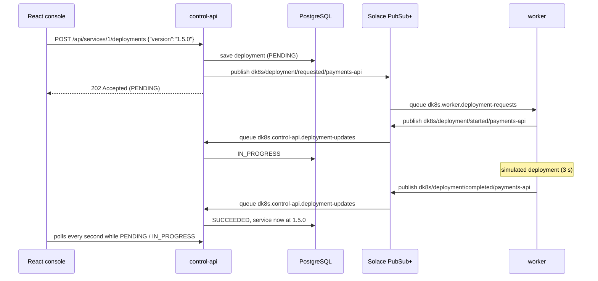

# DK8s

An event-driven engineering operations console for registering, monitoring, and managing the lifecycle of containerized services.

Engineers use DK8s to see which services are healthy, which version is deployed, what was deployed recently, and what operational events occurred, and to request deployments, restarts, and configuration changes.

> **Status:** `v0.2.0`. Deployments run asynchronously through **Solace PubSub+**: `control-api` publishes a request, a separate `worker` service processes it and publishes the result. The deployment itself is still **simulated**: the worker waits a few seconds and reports success; nothing is actually installed. See [CHANGELOG.md](CHANGELOG.md).

## What works today

- **`control-api`**: Java 17 / Spring Boot 4.1 REST API for registering services, requesting deployments, and reading deployment history and the event timeline. PostgreSQL 17 with Flyway migrations.
- **`worker`**: Spring Boot service that takes deployment requests from a Solace queue, simulates the deployment, and publishes `started`, then `completed` or `failed`.
- **Solace PubSub+ Standard** broker: topics for every event, durable queues so no request is lost if a service is down.
- **`frontend`**: React + TypeScript console (Vite, React Router, TanStack Query) with a dashboard, service list, live deployment progress, deployment history, an event timeline, and live Solace queue health (consumers and waiting messages).
- **Tests**: integration tests against a real PostgreSQL container (Testcontainers), unit tests for the worker, and frontend component tests.

## How a deployment flows



`control-api` and `worker` never call each other directly. Each **publishes to topics** and **consumes from its own queue**. The broker routes each topic to the queues subscribed to it.

### Topics and queues

| Topic | Published by | Delivered to queue |
|---|---|---|
| `dk8s/service/registered/{service}` | control-api | (none yet: recorded in the timeline) |
| `dk8s/deployment/requested/{service}` | control-api | `dk8s.worker.deployment-requests` |
| `dk8s/deployment/started/{service}` | worker | `dk8s.control-api.deployment-updates` |
| `dk8s/deployment/completed/{service}` | worker | `dk8s.control-api.deployment-updates` |
| `dk8s/deployment/failed/{service}` | worker | `dk8s.control-api.deployment-updates` |

Queues subscribe with wildcards (`dk8s/deployment/requested/>`), so new services need no broker changes. The queues and subscriptions are created by [`infra/solace/provision.sh`](infra/solace/provision.sh), which the `solace-init` Compose job runs through the broker's SEMP v2 management API.

### What happens when things fail

- **Worker is down:** requests wait in `dk8s.worker.deployment-requests` (persistent, guaranteed delivery). The deployment stays `PENDING` until the worker starts, then completes normally. Meanwhile the service page says *No worker is connected to the deployment queue (1 request waiting)*, using live queue statistics from the broker.
- **Broker is down:** `control-api` returns `503 Message broker unavailable` and rolls back, so no half-saved deployment is left behind.
- **Deployment fails:** deploy a version containing `fail` (for example `1.6.0-fail`). The worker publishes `failed`, the deployment is marked `FAILED` with a reason, the service keeps its previous version and becomes `DEGRADED`.
- **Duplicate message:** updates for a deployment that has already finished are ignored, so a redelivered message can't change anything twice.

## Prerequisites

- Java 17 or newer
- Node.js 22.22 or newer (for the frontend)
- Docker Desktop (running), with at least 2 CPUs and 4 GB of memory for the Solace broker

Maven doesn't need to be installed: `control-api` and `worker` include the Maven Wrapper (`./mvnw`).

## Running locally

Commands are for Git Bash, run from the repository root unless noted. You'll end up with three terminals: `control-api`, `worker`, and `frontend`.

**1. Create your local `.env`** (first time only)

```bash
cp .env.example .env
```

`.env` holds your local settings and is ignored by git. `.env.example` is the committed template with safe, disposable values. The defaults work as-is. If you created `.env` before Solace was added, copy the new `SOLACE_*` lines from `.env.example` into it.

**2. Start PostgreSQL and Solace**

```bash
docker compose up -d postgres solace solace-init
```

Docker Compose reads `.env` automatically. Solace takes about a minute to start; `solace-init` waits for it, creates the queues, and exits.

**3. Check that everything is ready**

```bash
docker compose ps -a
docker compose logs solace-init
```

`postgres` and `solace` should say `(healthy)`, and the `solace-init` log should end with `Solace provisioning complete.` The Solace Broker Manager web UI is at `http://localhost:8081` (user `admin`, password `admin`). Under **Queues** you can watch messages arrive and leave.

**4. Load `.env` into your terminal**

```bash
set -a
source .env
set +a
```

Spring Boot doesn't read `.env` files. These lines export every variable in `.env` into the current Git Bash session, so Java programs started from it can see them. Run them in **each new terminal**, and again after editing `.env`.

**5. Run the control API** (terminal 1)

```bash
cd control-api
./mvnw spring-boot:run
```

Flyway applies any pending migrations on startup. The API listens on `http://localhost:8080`.

**6. Run the worker** (terminal 2, after step 4)

```bash
cd worker
./mvnw spring-boot:run
```

**7. Run the frontend** (terminal 3)

```bash
cd frontend
npm install        # first time only
npm run dev
```

Open `http://localhost:5173`. The Vite dev server forwards `/api` requests to `control-api` on port 8080. See [frontend/README.md](frontend/README.md).

**8. Try it**

1. Register `payments-api` at version `1.4.2`.
2. On its page, deploy `1.5.0` and watch it go **Pending → In progress → Succeeded**, with each step in the Events list.
3. Deploy `1.6.0-fail` to see a failed deployment.
4. Stop the worker (`Ctrl+C`) and deploy `1.7.0`: it stays **Pending**, and the page explains that no worker is connected (the dashboard's **Messaging** panel shows the waiting request). Start the worker again and watch it complete.

### Configuration

All local settings live in `.env` (copied from `.env.example`):

| Variable | Read by | Purpose | Default |
|---|---|---|---|
| `POSTGRES_DB` | Docker Compose → postgres | Database to create | `dk8s` |
| `POSTGRES_USER` | Docker Compose → postgres | User to create | `dk8s` |
| `POSTGRES_PASSWORD` | Docker Compose → postgres | That user's password | `dk8s` |
| `POSTGRES_PORT` | Docker Compose | Port on your machine that forwards to PostgreSQL | `5432` |
| `DB_URL` | control-api | JDBC URL to connect to | `jdbc:postgresql://localhost:5432/dk8s` |
| `DB_USERNAME` | control-api | User to log in as | `dk8s` |
| `DB_PASSWORD` | control-api | Password to log in with | `dk8s` |
| `SOLACE_ADMIN_PASSWORD` | Docker Compose → solace, solace-init | Broker admin password | `admin` |
| `SOLACE_SMF_PORT` | Docker Compose | Port on your machine for SMF (the messaging protocol) | `55554` |
| `SOLACE_MANAGER_PORT` | Docker Compose | Port on your machine for the Broker Manager UI | `8081` |
| `SOLACE_HOST` | control-api, worker | Broker address | `tcp://localhost:55554` |
| `SOLACE_VPN` | control-api, worker | Message VPN | `default` |
| `SOLACE_USERNAME` | control-api, worker | Client username | `default` |
| `SOLACE_PASSWORD` | control-api, worker | Client password | `default` |
| `SOLACE_SEMP_URL` | control-api | Broker management API, for queue statistics | `http://localhost:8081` |
| `SOLACE_ADMIN_USERNAME` | control-api | Management API user (password: `SOLACE_ADMIN_PASSWORD`) | `admin` |
| `DEPLOYMENT_SIMULATION_DURATION` | worker | How long a simulated deployment takes | `3s` |

The `DB_*` values must match the `POSTGRES_*` values, and the port in `DB_URL` must equal `POSTGRES_PORT`. Likewise, the port in `SOLACE_HOST` must equal `SOLACE_SMF_PORT`. If a variable isn't set, `compose.yaml` and each `application.yaml` fall back to the defaults above.

**Changing the database password after the first start:** PostgreSQL only uses `POSTGRES_*` the first time it creates its data volume. To apply new credentials, delete the volume (this erases local data) and start again:

```bash
docker compose down -v
docker compose up -d postgres solace solace-init
```

## REST API

| Method | Path | Description | Responses |
|---|---|---|---|
| `GET` | `/api/services` | List managed services, sorted by name | `200` |
| `GET` | `/api/services/{id}` | Get one managed service | `200`, `404` |
| `POST` | `/api/services` | Register a managed service | `201`, `400`, `409`, `503` |
| `GET` | `/api/services/{id}/deployments` | Deployment history, newest first | `200`, `404` |
| `GET` | `/api/services/{id}/deployments/{deploymentId}` | Get one deployment | `200`, `404` |
| `POST` | `/api/services/{id}/deployments` | Request a deployment (processed by the worker) | `202`, `400`, `404`, `409`, `503` |
| `GET` | `/api/services/{id}/events` | Event timeline for one service, newest first | `200`, `404` |
| `GET` | `/api/events?limit=20` | Newest events across all services (max 100) | `200` |
| `GET` | `/api/messaging/queues` | Consumers and waiting messages for each DK8s queue, from the broker's SEMP v2 monitor API | `200` |
| `GET` | `/actuator/health` | Application health (includes database and broker) | `200`, `503` |

### Register a service

```bash
curl -i -X POST localhost:8080/api/services \
  -H "Content-Type: application/json" \
  -d '{"name": "payments-api", "description": "Handles card payments", "version": "1.4.2"}'
```

```json
{
  "id": 1,
  "name": "payments-api",
  "description": "Handles card payments",
  "version": "1.4.2",
  "status": "UNKNOWN",
  "createdAt": "2026-10-20T23:47:28.224502Z",
  "updatedAt": "2026-10-20T23:47:28.224502Z"
}
```

Request rules:

- `name`: required, unique, at most 63 characters, made of lowercase letters, digits, and hyphens (for example `payments-api`)
- `version`: required, at most 50 characters
- `description`: optional, at most 500 characters

New services start with status `UNKNOWN`. The possible statuses are `HEALTHY`, `DEGRADED`, `FAILED`, and `UNKNOWN`.

### Request a deployment

```bash
curl -i -X POST localhost:8080/api/services/1/deployments \
  -H "Content-Type: application/json" \
  -d '{"version": "1.5.0"}'
```

The response is `202 Accepted`: the request is saved and queued, and the worker finishes it shortly after.

```json
{
  "id": 1,
  "serviceId": 1,
  "version": "1.5.0",
  "previousVersion": "1.4.2",
  "status": "PENDING",
  "failureReason": null,
  "requestedAt": "2026-10-22T21:06:10.512304Z",
  "completedAt": null
}
```

Deployment statuses go `PENDING` → `IN_PROGRESS` → `SUCCEEDED` or `FAILED`. On success the service's `version` is updated and its status set to `HEALTHY`; on failure the version stays the same and the status becomes `DEGRADED`. Requesting a deployment while another one for the same service is still `PENDING` or `IN_PROGRESS` returns `409`.

### Errors

Errors use the standard [problem details](https://www.rfc-editor.org/rfc/rfc9457) JSON format. A validation failure looks like this:

```json
{
  "status": 400,
  "title": "Validation failed",
  "detail": "One or more fields are invalid",
  "instance": "/api/services",
  "errors": { "version": "must not be blank" }
}
```

## Running tests

No Solace broker is needed for any tests: messaging is replaced with mocks, and incoming messages are fed to the listeners directly.

```bash
cd control-api && ./mvnw test   # needs Docker: starts a throwaway PostgreSQL container
cd worker && ./mvnw test
cd frontend && npm test
```

## Project structure

```text
compose.yaml                      PostgreSQL, Solace broker, and the solace-init job
infra/solace/provision.sh         Creates the queues and topic subscriptions (SEMP v2)
frontend/                         React + TypeScript console (see frontend/README.md)
control-api/
  src/main/java/com/dk8s/controlapi/
    controller/                   REST endpoints
    service/                      Business logic
    repository/                   Database access (Spring Data JPA)
    entity/                       JPA entities and enums
    dto/                          API request/response shapes
    messaging/                    Solace publishing, listening, and message formats
    config/                       JMS (Solace) configuration
    exception/                    Error types and JSON error handling
  src/main/resources/
    application.yaml              App configuration
    db/migration/                 Flyway SQL migrations
worker/
  src/main/java/com/dk8s/worker/
    messaging/                    Request listener, publisher, and message formats
    simulation/                   The simulated deployment
```
