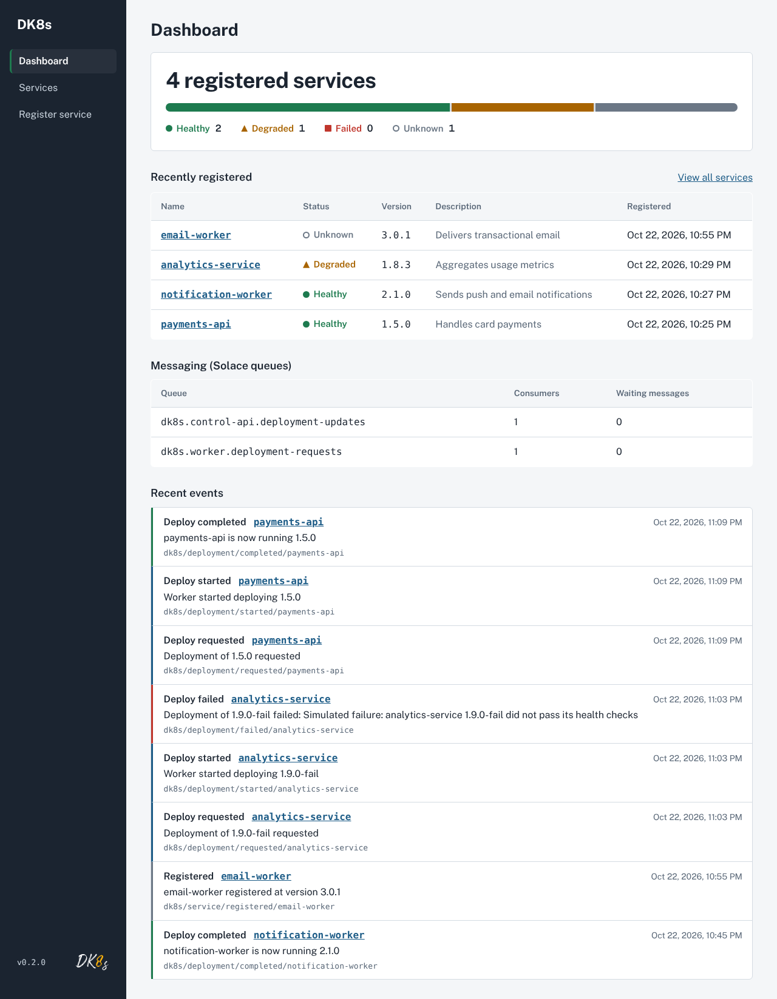
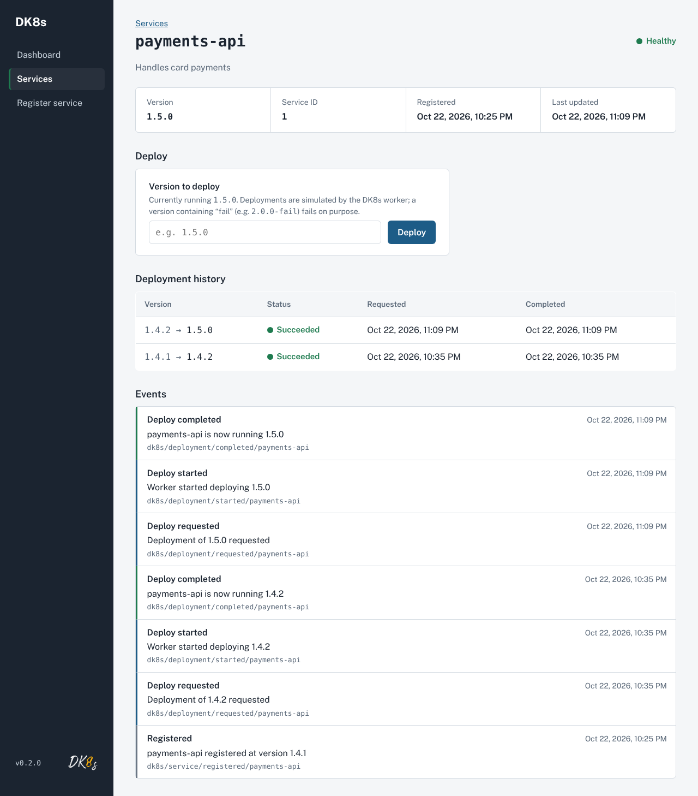
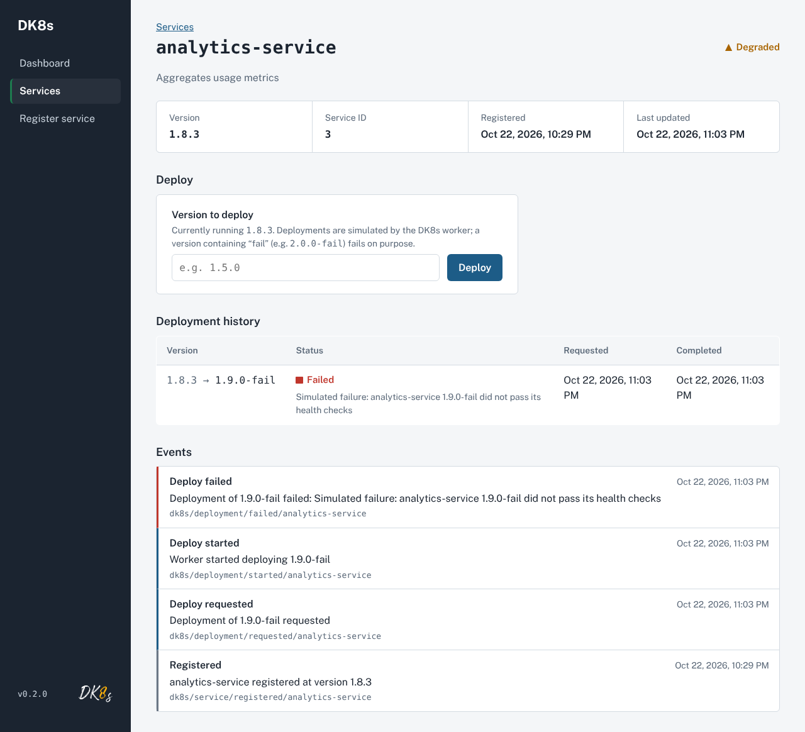
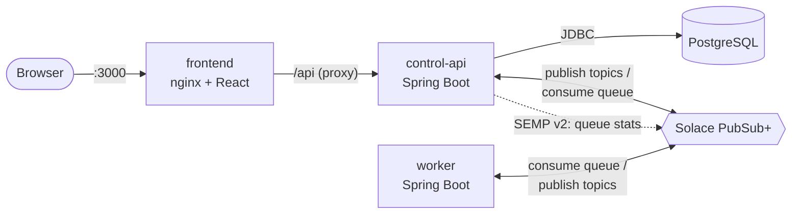
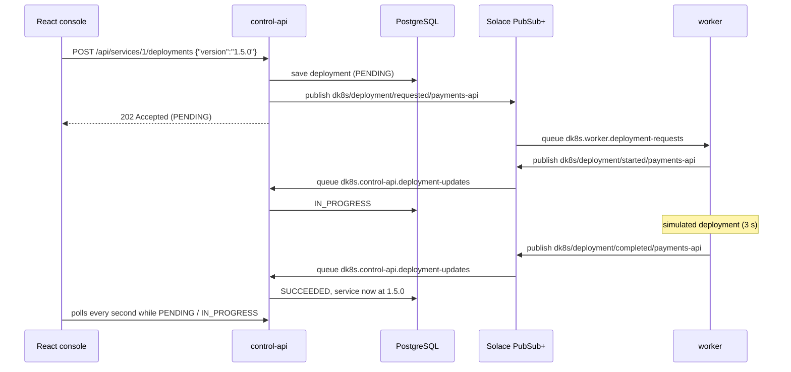
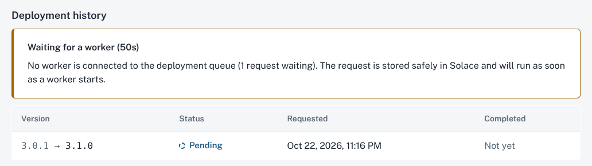

# DK8s

[](https://github.com/DanielKhojaste/dk8s/actions/workflows/ci.yml)

An event-driven engineering operations console for registering, monitoring, and managing the lifecycle of services.

Engineers use DK8s to see which services are healthy, which version each one runs, and what happened recently, and to request deployments that are processed asynchronously through **Solace PubSub+**.



> **Status:** latest release `v0.3.0` (see [CHANGELOG.md](CHANGELOG.md)). Deployments are **simulated**: the worker waits a few seconds and reports the result, but nothing is actually installed. Everything around that (the API, the messaging, the database, the UI) is real.

## Contents

- [What it does](#what-it-does)
- [Why I built this](#why-i-built-this)
- [Quick start](#quick-start)
- [Architecture](#architecture)
- [How a deployment flows](#how-a-deployment-flows)
- [What happens when things fail](#what-happens-when-things-fail)
- [Tech stack](#tech-stack)
- [Tests and CI](#tests-and-ci)
- [Local development](#local-development)
- [REST API](#rest-api)
- [Project structure](#project-structure)
- [Roadmap](#roadmap)

## What it does

- **Service registry:** register services with a name, version, and description; see their health at a glance.
- **Asynchronous deployments:** request a new version, then watch it go **Pending → In progress → Succeeded / Failed** live, without refreshing.
- **Event timeline:** every message that travels through Solace is recorded with its topic, per service and across the system.
- **Messaging health:** the dashboard reads live queue statistics from the broker (connected consumers, waiting messages) and explains a stuck deployment, for example *"No worker is connected to the deployment queue (1 request waiting)"*.
- **Failure handling:** failed deployments keep the previous version and mark the service `DEGRADED`; requests survive a worker outage; a broker outage returns a clear `503` with nothing half-saved.

| Service detail: deploy, history, and events | A failed deployment |
|---|---|
|  |  |

## Why I built this

I wanted hands-on experience with the kind of work platform and operations teams do every day: Java microservices behind a REST API, a relational database with migrations, event-driven communication through a message broker, a React operations UI, containers, automated tests, and CI. DK8s puts all of these into one small, coherent system, built around **Solace PubSub+** as the event broker.

## Quick start

Requirements: **Docker Desktop**, running, with at least 4 GB of memory (the Solace broker needs about 2 GB).

```bash
git clone https://github.com/DanielKhojaste/dk8s.git
cd dk8s
docker compose up --build
```

The first run downloads images and builds the apps (a few minutes). The broker takes about a minute to start. When the logs settle, open **http://localhost:3000**.

Then try it:

1. **Register service** → `payments-api`, version `1.4.2`.
2. On its page, deploy `1.5.0` and watch it go **Pending → In progress → Succeeded**, with each step in **Events**.
3. Deploy `1.6.0-fail` to see a failed deployment: the service keeps `1.5.0` and turns **Degraded**.
4. Stop the worker with `docker compose stop worker`, then deploy `1.7.0`: it stays **Pending**, and the page explains that no worker is connected. Run `docker compose start worker` and watch it complete.

Other useful URLs and commands:

| What | Where |
|---|---|
| DK8s console | http://localhost:3000 |
| REST API | http://localhost:8080/api/services |
| Solace Broker Manager (user `admin`, password `admin`) | http://localhost:8081 |
| Stop everything | `docker compose down` (add `-v` to also delete the database) |

Settings such as ports and passwords can be changed by copying `.env.example` to `.env` (see [Configuration](#configuration)). The defaults work without it.

## Architecture



Six containers, started by [`compose.yaml`](compose.yaml): `postgres`, `solace`, a one-off `solace-init` job that creates the queues, and the three DK8s apps. nginx serves the React build and forwards `/api` to `control-api`, so the browser only ever talks to one origin and no CORS configuration is needed.

## How a deployment flows



`control-api` and `worker` never call each other directly. Each **publishes to topics** and **consumes from its own queue**; the broker routes each topic to the queues subscribed to it.

| Topic | Published by | Delivered to queue |
|---|---|---|
| `dk8s/service/registered/{service}` | control-api | (none yet: recorded in the timeline) |
| `dk8s/deployment/requested/{service}` | control-api | `dk8s.worker.deployment-requests` |
| `dk8s/deployment/started/{service}` | worker | `dk8s.control-api.deployment-updates` |
| `dk8s/deployment/completed/{service}` | worker | `dk8s.control-api.deployment-updates` |
| `dk8s/deployment/failed/{service}` | worker | `dk8s.control-api.deployment-updates` |

Queues subscribe with wildcards (`dk8s/deployment/requested/>`), so new services need no broker changes. The queues and subscriptions are created by [`infra/solace/provision.sh`](infra/solace/provision.sh) through the broker's SEMP v2 management API.

## What happens when things fail

- **Worker is down:** requests wait in `dk8s.worker.deployment-requests` (persistent, guaranteed delivery). The deployment stays `PENDING` until a worker connects, then completes normally. Meanwhile, DK8s reads the queue's consumer count from the broker and says why it's waiting:

  

- **Broker is down:** `control-api` returns `503 Message broker unavailable` and rolls the transaction back, so no half-saved deployment is left behind. Its health check reports `DOWN` until the broker is back.
- **Deployment fails:** the worker publishes `failed` with a reason; the deployment is marked `FAILED`, the service keeps its previous version and becomes `DEGRADED`.
- **Duplicate or late message:** updates for a deployment that has already finished are ignored, so a redelivered message can't change anything twice. Each queue redelivers a failed message at most 3 times.

## Tech stack

| Area | Technology |
|---|---|
| Backend | Java 17, Spring Boot 4.1 (Web MVC, Data JPA, Validation, Actuator, JMS) |
| Database | PostgreSQL 17, Flyway migrations |
| Messaging | Solace PubSub+ Standard, Solace JMS Spring Boot starter, SEMP v2 |
| Frontend | React 19, TypeScript, Vite, React Router, TanStack Query |
| Containers | Docker (multi-stage builds), Docker Compose, nginx |
| Testing | JUnit 5, Spring Boot Test, MockMvc, Testcontainers, Mockito, Vitest, Testing Library |
| CI | GitHub Actions |

## Tests and CI

Every push to `main`/`dev` and every pull request runs [the CI workflow](.github/workflows/ci.yml):

| Job | What it checks |
|---|---|
| `control-api` | Build + 19 tests: REST endpoints, the asynchronous deployment lifecycle, failure paths (broker down, duplicate messages), queue statistics parsing. Runs against a real PostgreSQL started by Testcontainers. |
| `worker` | Build + 5 tests: the simulated deployment and the exact messages and topics it publishes. |
| `frontend` | Lint, type-check, 12 component tests, production build. |
| `docker` | Builds all three images, after the jobs above pass. |

No Solace broker is needed for any test: outgoing messages are captured by a mock, incoming messages are fed to the listeners as JSON, and broker statistics come from a mock HTTP server.

Run the same checks locally:

```bash
cd control-api && ./mvnw verify   # needs Docker (Testcontainers)
cd worker && ./mvnw verify
cd frontend && npm ci && npm run lint && npm run typecheck && npm test
```

## Local development

To work on one app with fast restarts, run only the infrastructure in Docker and the apps on your machine. Requirements: Java 17+, Node.js 22.22+, Docker Desktop. Maven isn't needed: each Java app includes the Maven Wrapper (`./mvnw`). Commands are for Git Bash, from the repository root.

```bash
cp .env.example .env                                  # first time only
docker compose up -d postgres solace solace-init      # infrastructure only
set -a; source .env; set +a                           # export .env into this terminal (Spring doesn't read .env)
```

Then, each in its own terminal (run the `set -a; source .env; set +a` line in each new terminal first):

```bash
cd control-api && ./mvnw spring-boot:run              # http://localhost:8080
cd worker && ./mvnw spring-boot:run
cd frontend && npm install && npm run dev             # http://localhost:5173 (proxies /api to :8080)
```

Don't run these at the same time as the full `docker compose up`: both use ports 8080 and 5432.

### Configuration

All settings live in `.env` (copied from `.env.example`); every value has a default.

| Variable | Read by | Purpose | Default |
|---|---|---|---|
| `POSTGRES_DB` | Docker Compose → postgres | Database to create | `dk8s` |
| `POSTGRES_USER` | Docker Compose → postgres | User to create | `dk8s` |
| `POSTGRES_PASSWORD` | Docker Compose → postgres | That user's password | `dk8s` |
| `POSTGRES_PORT` | Docker Compose | Port on your machine for PostgreSQL | `5432` |
| `DB_URL` | control-api (local dev) | JDBC URL | `jdbc:postgresql://localhost:5432/dk8s` |
| `DB_USERNAME` | control-api (local dev) | Database user | `dk8s` |
| `DB_PASSWORD` | control-api (local dev) | Database password | `dk8s` |
| `SOLACE_ADMIN_PASSWORD` | solace, solace-init, control-api | Broker admin password | `admin` |
| `SOLACE_SMF_PORT` | Docker Compose | Port on your machine for SMF (the messaging protocol) | `55554` |
| `SOLACE_MANAGER_PORT` | Docker Compose | Port on your machine for the Broker Manager UI | `8081` |
| `SOLACE_HOST` | control-api, worker (local dev) | Broker address | `tcp://localhost:55554` |
| `SOLACE_VPN` | control-api, worker | Message VPN | `default` |
| `SOLACE_USERNAME` | control-api, worker | Client username | `default` |
| `SOLACE_PASSWORD` | control-api, worker | Client password | `default` |
| `SOLACE_SEMP_URL` | control-api (local dev) | Broker management API, for queue statistics | `http://localhost:8081` |
| `SOLACE_ADMIN_USERNAME` | control-api | Management API user | `admin` |
| `DEPLOYMENT_SIMULATION_DURATION` | worker | How long a simulated deployment takes | `3s` |
| `CONTROL_API_PORT` | Docker Compose | Port on your machine for control-api | `8080` |
| `FRONTEND_PORT` | Docker Compose | Port on your machine for the console | `3000` |

When everything runs in Docker, Compose builds the apps' database and broker addresses from the `POSTGRES_*` and `SOLACE_*` values itself, so the "(local dev)" variables only matter when running the apps on your machine. There, the `DB_*` values must match `POSTGRES_*`, and the ports in `DB_URL` and `SOLACE_HOST` must match `POSTGRES_PORT` and `SOLACE_SMF_PORT`.

PostgreSQL only applies `POSTGRES_*` the first time it creates its data volume. To change the password later, run `docker compose down -v` (this erases local data) and start again.

## REST API

| Method | Path | Description | Responses |
|---|---|---|---|
| `GET` | `/api/services` | List managed services, sorted by name | `200` |
| `GET` | `/api/services/{id}` | Get one managed service | `200`, `404` |
| `POST` | `/api/services` | Register a managed service | `201`, `400`, `409`, `503` |
| `GET` | `/api/services/{id}/deployments` | Deployment history, newest first | `200`, `404` |
| `GET` | `/api/services/{id}/deployments/{deploymentId}` | Get one deployment | `200`, `404` |
| `POST` | `/api/services/{id}/deployments` | Request a deployment (processed by the worker) | `202`, `400`, `404`, `409`, `503` |
| `GET` | `/api/services/{id}/events` | Event timeline for one service, newest first | `200`, `404` |
| `GET` | `/api/events?limit=20` | Newest events across all services (max 100) | `200` |
| `GET` | `/api/messaging/queues` | Consumers and waiting messages for each DK8s queue, from the broker's SEMP v2 monitor API | `200` |
| `GET` | `/actuator/health` | Application health (includes database and broker) | `200`, `503` |

### Register a service

```bash
curl -i -X POST localhost:8080/api/services \
  -H "Content-Type: application/json" \
  -d '{"name": "payments-api", "description": "Handles card payments", "version": "1.4.2"}'
```

```json
{
  "id": 1,
  "name": "payments-api",
  "description": "Handles card payments",
  "version": "1.4.2",
  "status": "UNKNOWN",
  "createdAt": "2026-10-20T23:47:28.224502Z",
  "updatedAt": "2026-10-20T23:47:28.224502Z"
}
```

Request rules:

- `name`: required, unique, at most 63 characters, made of lowercase letters, digits, and hyphens (for example `payments-api`)
- `version`: required, at most 50 characters
- `description`: optional, at most 500 characters

New services start with status `UNKNOWN`. The possible statuses are `HEALTHY`, `DEGRADED`, `FAILED`, and `UNKNOWN`.

### Request a deployment

```bash
curl -i -X POST localhost:8080/api/services/1/deployments \
  -H "Content-Type: application/json" \
  -d '{"version": "1.5.0"}'
```

The response is `202 Accepted`: the request is saved and queued, and the worker finishes it shortly after.

```json
{
  "id": 1,
  "serviceId": 1,
  "version": "1.5.0",
  "previousVersion": "1.4.2",
  "status": "PENDING",
  "failureReason": null,
  "requestedAt": "2026-10-22T21:06:10.512304Z",
  "completedAt": null
}
```

Deployment statuses go `PENDING` → `IN_PROGRESS` → `SUCCEEDED` or `FAILED`. On success the service's `version` is updated and its status set to `HEALTHY`; on failure the version stays the same and the status becomes `DEGRADED`. Requesting a deployment while another one for the same service is still `PENDING` or `IN_PROGRESS` returns `409`.

### Errors

Errors use the standard [problem details](https://www.rfc-editor.org/rfc/rfc9457) JSON format. A validation failure looks like this:

```json
{
  "status": 400,
  "title": "Validation failed",
  "detail": "One or more fields are invalid",
  "instance": "/api/services",
  "errors": { "version": "must not be blank" }
}
```

## Project structure

```text
compose.yaml                      All services: postgres, solace, solace-init, control-api, worker, frontend
.env.example                      Every setting, with safe local defaults
.github/workflows/ci.yml          CI: tests, builds, Docker images
infra/solace/provision.sh         Creates the queues and topic subscriptions (SEMP v2)
docs/screenshots/                 Images used in this README
control-api/                      Spring Boot REST API (Dockerfile inside)
  src/main/java/com/dk8s/controlapi/
    controller/                   REST endpoints
    service/                      Business logic
    repository/                   Database access (Spring Data JPA)
    entity/                       JPA entities and enums
    dto/                          API request/response shapes
    messaging/                    Solace publishing, listening, message formats, broker monitor
    config/                       JMS and SEMP client configuration
    exception/                    Error types and JSON error handling
  src/main/resources/
    application.yaml              App configuration
    db/migration/                 Flyway SQL migrations (V1–V3)
worker/                           Spring Boot deployment worker (Dockerfile inside)
  src/main/java/com/dk8s/worker/
    messaging/                    Request listener, publisher, message formats
    simulation/                   The simulated deployment
frontend/                         React + TypeScript console (Dockerfile + nginx.conf inside)
```

## Roadmap

Planned, not built yet:

- **Kubernetes + Helm:** run DK8s on a local cluster and package it as a Helm chart.
- **Real deployments:** have the worker roll out actual container versions on Kubernetes instead of simulating them.
- **Observability:** metrics, traces, and dashboards (Prometheus, Grafana, OpenTelemetry) around the deployment flow.
- **Messaging reliability:** dead-letter queue, retries with backoff, and idempotency keys.
